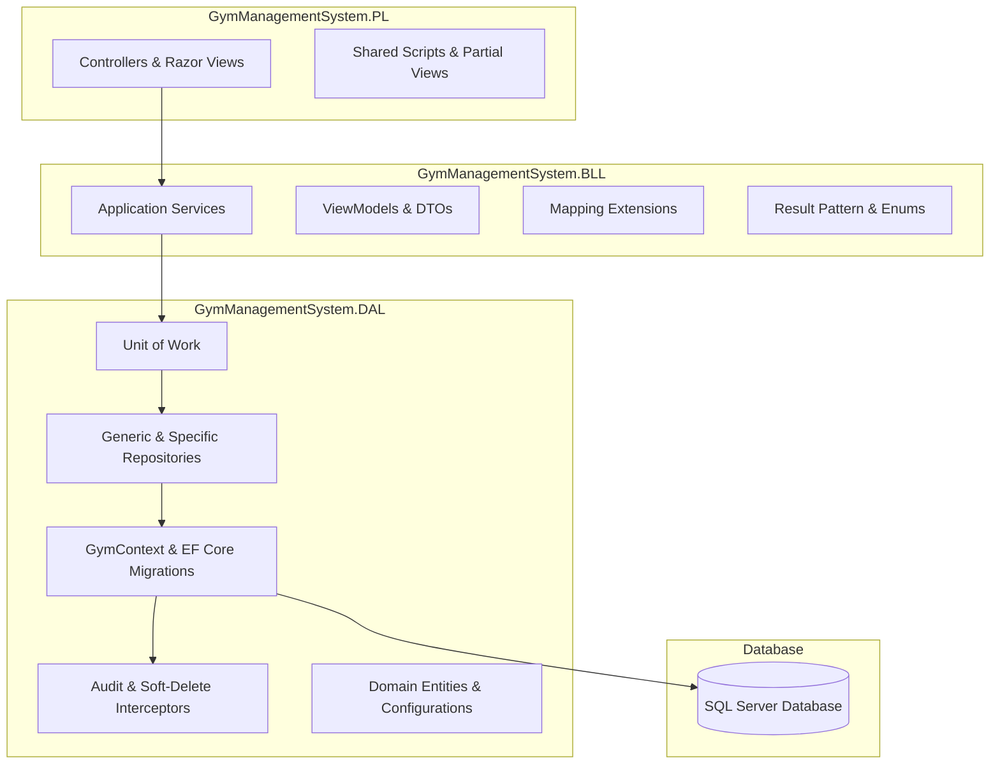

# 🏋️‍♂️ Gym Management System (MVC)

[](https://dotnet.microsoft.com/)
[](https://learn.microsoft.com/en-us/ef/core/)
[](https://www.microsoft.com/sql-server)
[](https://learn.microsoft.com/en-us/dotnet/architecture/)
[](https://learn.microsoft.com/en-us/dotnet/csharp/)

---

## 📖 Table of Contents

- [Overview](#-overview)
- [Key Features](#-key-features)
- [Architecture & Design Patterns](#-architecture--design-patterns)
- [Domain Models](#-domain-models)
- [Tech Stack](#-tech-stack)
- [Getting Started](#-getting-started)
- [Project Structure](#-project-structure)

---

## 📋 Overview

**Gym Management System** is an enterprise-grade ASP.NET Core MVC application built with **.NET 8.0** and **Entity Framework Core**. It is designed to efficiently manage full-scale gym operations, including member subscriptions, trainer schedules, workout session bookings, membership plans, health tracking records, and automated business rule validations.

---

## ✨ Key Features

- 🏗️ **Clean N-Tier Architecture**: Strict separation of concerns between Data Access Layer (`DAL`), Business Logic Layer (`BLL`), and Presentation Layer (`PL`).
- 🔄 **Unit of Work & Repository Pattern**: Centralized transaction management with type-safe generic repositories and domain-specific repositories.
- ⚡ **Dynamic Cascading Dropdowns**: Real-time AJAX/Fetch-driven dropdowns (e.g., dynamically loading qualified trainers based on the selected session category).
- 🛡️ **Two-Layer Validation**: Business logic and schedule conflict validations applied on both client-side and server-side (Result Pattern).
- 🕒 **EF Core Interceptors (Soft Delete & Auditing)**: Custom `AuditColumnsInterceptor` automatically tracks `CreatedAt`, `UpdatedAt`, and performs soft deletion (`IsDeleted`, `DeletedAt`).
- 👥 **Comprehensive Member & Trainer Management**: Full CRUD operations, health record logging, and specialization tracking.
- 💳 **Membership & Subscription Lifecycle**: Plan assignment, active membership validation, and expiration management.
- 📅 **Session Scheduling & Bookings**: Capacity enforcement, trainer conflict detection, and eligible member attendance tracking.
- 🌱 **Automated Database Seeding & Migrations**: Automated execution of EF Core migrations and initial lookup seeding on application startup.

---

## 🏛️ Architecture & Design Patterns

The project follows the **3-Tier / Layered Architecture** to maintain clean code separation, scalability, and testability:



### Advanced Patterns & Concepts Implemented:
1. **Repository & Unit of Work Pattern**: Decouples business logic from EF Core DbContext and coordinates multi-repository transactions.
2. **Result Pattern**: Eliminates unhandled exceptions for business flow control by returning structured `Result` objects with explicit error messages and property names.
3. **EF Core Interceptors**: `AuditColumnsInterceptor` automatically manages audit timestamps and soft deletion on entity persistence.
4. **ViewModel Mapping Extensions**: High-performance manual mapping between Domain Entities and ViewModels.
5. **Partial Views & Modular Scripts**: Modularized front-end scripts (e.g., `_SessionScriptsPartial.cshtml`, `_ValidationScriptsPartial.cshtml`).

---

## 🗂️ Domain Models

| Entity | Description |
| :--- | :--- |
| **`Member`** | Stores member personal info, contact details, and related health records. |
| **`Trainer`** | Stores trainer profiles, hire dates, and specializations (`Speciality`). |
| **`Plan`** | Defines membership packages, duration, pricing, and active status. |
| **`Membership`** | Links members to plans with start date, end date, and validity tracking. |
| **`Session`** | Training sessions scheduled by trainers with capacity limits and category association. |
| **`Category`** | Organizes session types (e.g., Strength, Cardio, Yoga, CrossFit, Bodybuilding). |
| **`Booking`** | Records member attendance and reservations for sessions. |
| **`HealthRecord`** | Tracks member fitness metrics (height, weight, medical conditions, goals). |
| **`BaseEntity`** | Base class providing `ID`, `CreatedAt`, `UpdatedAt`, `IsDeleted`, and `DeletedAt`. |

---

## 💻 Tech Stack

- **Framework**: [.NET 8.0](https://dotnet.microsoft.com/) (C# 12)
- **Web App**: ASP.NET Core MVC (Razor Views, Bootstrap 5, Bootstrap Icons)
- **ORM**: Entity Framework Core 8.0
- **Database**: Microsoft SQL Server
- **Client Scripting**: Vanilla JavaScript (Async/Await, Fetch API) & jQuery Validation
- **Architecture**: N-Tier (PL, BLL, DAL), Unit of Work, Repository Pattern

---

## 🚀 Getting Started

### 1️⃣ Prerequisites
- [.NET 8.0 SDK](https://dotnet.microsoft.com/download/dotnet/8.0) installed.
- [SQL Server / LocalDB](https://www.microsoft.com/sql-server/) installed and running.
- [Visual Studio 2022](https://visualstudio.microsoft.com/) or [VS Code](https://code.visualstudio.com/).

### 2️⃣ Clone the Repository
```bash
git clone https://github.com/Mary-Raafat/GymManagementSystemMVC.git
cd GymManagementSystemMVC
```

### 3️⃣ Configure Database Connection
Open `GymManagementSystem/appsettings.json` and adjust your SQL Server connection string:

```json
{
  "ConnectionStrings": {
    "DefaultConnection": "Server=.;Database=GymManagementSystemDb;Trusted_Connection=True;TrustServerCertificate=True;"
  }
}
```

### 4️⃣ Build & Run
Run the following commands in your terminal:

```bash
# Restore dependencies
dotnet restore

# Build the solution
dotnet build

# Run the MVC project (Migrations & Initial Lookups Seed automatically on startup!)
dotnet run --project GymManagementSystem/GymManagementSystem.PL.csproj
```

---

## 📁 Project Structure

```text
GymManagementSystem/
├── 📄 README.md                             # Project Documentation
├── 📄 GymManagementSystemMVC.sln            # Solution File
│
├── 📂 GymManagementSystem/                  # Presentation Layer (PL - ASP.NET Core MVC)
│   ├── 📂 Controllers/                      # MVC Controllers (Member, Trainer, Session, Membership, Plans)
│   ├── 📂 Views/                            # Razor UI Views & Partial Views
│   ├── 📂 wwwroot/                          # Static Assets (CSS, JS, Vendor Libraries)
│   └── 📄 Program.cs                        # Application Entry Point & Middleware Pipeline
│
├── 📂 GymManagementSystem.BLL/              # Business Logic Layer (BLL)
│   ├── 📂 Services/                         # Business Services & Contracts (ISessionService, etc.)
│   ├── 📂 ViewModels/                       # Data Transfer & Form View Models
│   ├── 📂 Mapping/                          # Extension Methods for Entity-to-ViewModel Mapping
│   ├── 📂 Common/                           # Result Pattern & Shared Helpers
│   └── 📄 ServiceCollectionExtensionsBLL.cs  # BLL Dependency Injection Registration
│
└── 📂 GymManagementSystem.DAL/              # Data Access Layer (DAL)
    ├── 📂 Dbcontexts/                       # GymContext Definition & Configuration
    ├── 📂 Models/                           # Entity Framework Domain Models
    ├── 📂 Interfaces/                       # Repository & Unit of Work Contracts
    ├── 📂 Repositories/                     # Generic & Specific Repository Implementations
    ├── 📂 Interceptors/                     # EF Core Audit & Soft-Delete Interceptors
    ├── 📂 Migrations/                       # Database Migrations
    ├── 📂 Data/                             # Seed Data Classes (Users, Categories, Plans)
    └── 📄 ServiceCollectionExtensionsDAL.cs  # DAL Dependency Injection Registration
```

---

<p align="center">
  Crafted with ❤️ for <b>C# Advanced Course</b>
</p>
